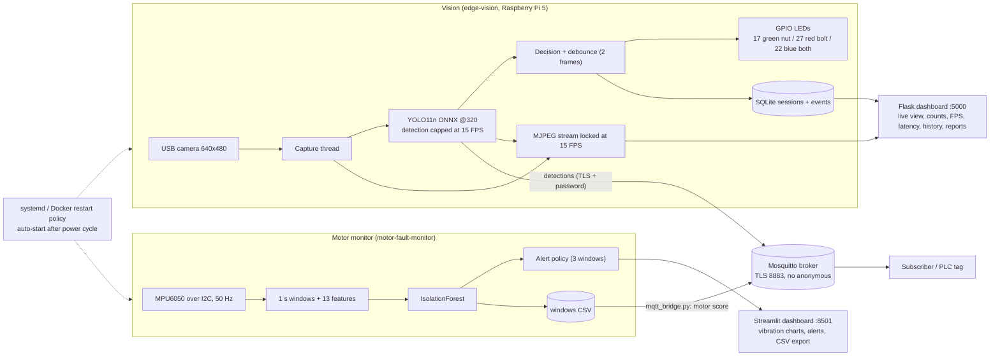

# System architecture (camera + motor monitor + dashboard)

Status: each box exists in code. Tested on a PC only: the vision pipeline with a fake camera, the secure broker, both publishers. Not yet tested on the Pi: camera, GPIO LEDs, MPU6050, Docker/systemd auto-start, the combined dashboard.
